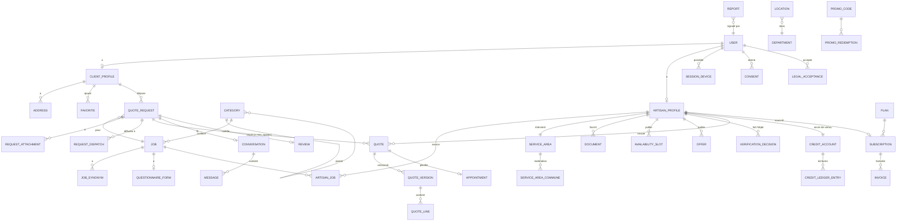

# Modèle de données — TrouveMoi.com

> Statut : **proposition — Étape 0**. Base : CDC annexe C, complétée par les règles des annexes D et G et par les exigences de sécurité du cadrage.
> Conventions : PostgreSQL 16 + PostGIS ; un schéma par module (ADR-0003) ; PK `uuid` v7 ; horodatages `timestamptz` en UTC ; montants en **centimes** (`bigint`) avec `currency char(3)` ; statuts en `text` + `CHECK` (miroir des enums du domaine) ; pas de `ON DELETE CASCADE` sur les données métier (suppression RGPD = anonymisation, RG-090).

---

## 1. MCD (vue d'ensemble)

## 2. Tables par module

Légende : **PK** clé primaire · **UQ** unicité · **IX** index · **FK** clé étrangère · **CK** check · 🔒 donnée sensible (chiffrée ou à accès restreint).

### 2.1 `identity`

| Table | Colonnes principales | Contraintes / index |
|---|---|---|
| `user_account` (T-201 ; « user » est réservé en SQL) | id, email, email_canonical, password_hash (Argon2id), passwordless (T-402e : compte « créer plus tard », connecté par son lien d'activation), kind (`client`/`artisan`), status (`pending_email`/`active`/`suspended`/`deletion_requested`/`anonymized`), first_name, last_name, email_verified_at, last_login_at, password_changed_at, deletion_requested_at, anonymized_at, created_at, updated_at, version — *à venir avec leurs tickets : phone 🔒 / phone_verified_at, avatar (→ `stored_file`)* | **UQ** `email_canonical` WHERE status <> 'anonymized' · **CK** actif ⇒ e-mail vérifié · **CK** empreinte `$argon2id$` (ou marqueur inutilisable si anonymisé) · **IX** (status, created_at) · **IX** (last_login_at) pour la purge d'inactivité |
| `password_reset_token` (T-205) | id, user_id (FK différée), token_hash (SHA-256 d'un secret de 256 bits), requested_ip_hash, created_at, expires_at (`auth.password_reset_ttl_min`), used_at, revoked_at | **UQ** token_hash · **UQ** (user_id) des liens actifs (une demande révoque la précédente) · **IX** (user_id, created_at) — quotas 3 / h / compte et 10 / h / IP appliqués par le limiteur |
| `email_verification_token` (T-203) | id, user_id (FK différée), purpose (`signup`/`email_change`), new_email, token_hash (SHA-256 d'un secret de 256 bits, jamais le jeton), created_at, expires_at (`auth.email_verification_ttl_hours`), used_at, revoked_at | **UQ** token_hash · **UQ** (user_id, purpose) des jetons actifs (un renvoi révoque le précédent) · **CK** changement ⇒ nouvelle adresse |
| `session_device` (T-204) | id, user_id (FK différée), device_hash (SHA-256 d'un identifiant aléatoire en cookie `tm_device`, aucune empreinte navigateur), description (« Chrome sur Windows »), ip_hash, first_seen_at, last_seen_at, revoked_at | **UQ** (user_id, device_hash) — sert à E-05 (nouvel appareil) |
| `remember_me_token` | — | pas de table : cookie « rester connecté » **signé** (Symfony, `signature_properties` : empreinte du mot de passe, e-mail), invalidé par tout changement de l'un ou l'autre |
| `consent` | id, user_id NULL, anon_id, category, granted, policy_version, created_at, expires_at | **IX** (user_id, category, created_at DESC) ; append-only |
| `client_profile` (T-202) | user_id (PK, FK différée), type (`particulier`/`professionnel`), company_name, siret, siret_verified, postal_code, newsletter_opt_in_at, created_at, updated_at | **CK** particulier ⇒ ni raison sociale ni SIRET · **CK** professionnel ⇒ raison sociale · **CK** vérifié ⇒ SIRET présent |
| `legal_document` | id, type (`cgu`/`cgv`/`cgv_pro`/`privacy`), version, title, content_html (assaini), content_hash, substantial, published_at, published_by | **UQ** (type, version) · **immuable** (trigger) |
| `legal_acceptance` | id, user_id (FK différée : compte inséré au flush), legal_document_id, content_hash (copie du texte accepté), accepted_at, ip_hash | **UQ** (user_id, legal_document_id) ; append-only (RG-002, trigger) |
| `login_attempt` | — | pas de table : le rate limiter Redis gère compte + IP (RG-045) ; les échecs sont tracés dans l'AuditLog |

### 2.2 `catalog`

| Table | Colonnes | Contraintes / index |
|---|---|---|
| `category` | id, parent_id NULL, level (`category`/`subcategory`), name, slug, description, image_key, image_alt, icon, accent_token, featured, position, active, seo (jsonb) | **UQ** slug · **IX** (parent_id, position) |
| `job` | id, subcategory_id, name, slug, description, required_documents (jsonb), insurance_required, decennial_required, labels (jsonb), active, seo (jsonb), replaced_by_job_id | **UQ** slug · **IX** (subcategory_id, active) |
| *(synonymes)* | colonne `catalog.job.synonyms` **jsonb** (liste dédoublonnée sans casse ni accents par l'agrégat) | **IX GIN** `job_synonyms_idx` ; la recherche plein texte des synonymes passe par Meilisearch (T-114) — choix T-112 au lieu d'une table dédiée |
| `questionnaire_form` (T-402a) | id, job_id → `catalog.job`, version, schema (jsonb : questions ordonnées — clé, libellé, type `choice`/`multi`/`yesno`/`text`/`number`, obligatoire, options, condition d'affichage `show_if`, bornes, présentation `widget` `chips`/`radio`/`select`, demi-largeur `half`), active, created_at | **UQ** (job_id, version) · **UQ** (job_id) WHERE active · nouvelle version seulement si le schéma change (les demandes gardent la leur) ; table DBAL (hors filtre ORM) |
| `price_range` | id, job_id, label, low_cents, high_cents, unit, source (`manual`/`computed`), sample_size, updated_at | **CK** low ≤ high |
| `region` / `department` | code, name, (region_code) | PK code |
| `commune` (T-113) | insee (PK, CK format), name, slug, postal_codes text[], department_code (FK), population, centroid `geography(Point,4326)`, active, seo_page_enabled, seo_text | **IX GiST** centroid · **IX GIN** postal_codes · **IX GIN trigram** `immutable_unaccent(lower(name))` · **UQ** slug (`nom-codepostal`, stable une fois attribué) · communes disparues désactivées, jamais supprimées |

### 2.3 `artisan`

| Table | Colonnes | Contraintes / index |
|---|---|---|
| `artisan_profile` (T-207a/b : colonnes du tunnel ; slug, notes… avec leurs tickets) | id, user_id (**UQ**), status (`incomplete`/`pending_verification`/`verified`/`rejected`/`suspended`), completed_step (1–7), siret, siren, company_name, trade_name, legal_form (catégorie juridique INSEE), ape, vat_number, vat_status (`assujetti`/`franchise`), hq_street, hq_postal_code, hq_city, hq_city_insee (adresse du siège : donnée publique Sirene ; un entrepreneur individuel « non diffusible » n'en expose aucune), company_created_on, siret_verified_at (null = vérification différée), jobs jsonb (métiers + principal ; projection `artisan_job` à T-208), area_mode (`radius`/`list`), area_center_insee (commune de départ, RG-022), area_radius_km, area_departments jsonb, area_communes jsonb, insurances jsonb (nature, assureur, police, fin de validité), qualifications jsonb (label, numéro, validité), short_description (300), logo_file_id → `shared.stored_file` (usage `artisan_logo`), submitted_at, verified_at, status_reason (motif normalisé, `more_info`, `suspended`), status_comment, status_changed_at, status_changed_by, completion_rate (0–100, PR08.1), hidden_at, hidden_reason (masquage RG-130, T-212), phone_public (option « afficher mon téléphone », RG-030, défaut faux, T-303), presentation jsonb (slogan, description, points forts, langues, années, clients — T-309a), services jsonb (intitulé, tarif indicatif), opening_hours jsonb (plages par jour, urgences), created_at, updated_at, version | **UQ** siret (RG-041) · **CK** étape ≥ 2 ⇒ SIRET et raison sociale · **CK** étape ≥ 3 ⇒ au moins un métier · **CK** statut ≠ incomplet ⇒ étape 7 et submitted_at · **CK** étape ≥ 4 ⇒ zone · **CK** étape 7 ⇒ description · **CK** vérifié ⇒ verified_at · **CK** refusé ⇒ motif · **IX** (status, updated_at) · **IX** completion_rate WHERE vérifié (RG-011) |
| `artisan_job` (T-208, projection de `jobs`) | artisan_id, job_id (sans FK vers catalog : frontière de module), is_main | **PK** (artisan_id, job_id) · **UQ** (artisan_id) WHERE is_main · **IX** job_id · nombre maximum (`pro.max_jobs`) contrôlé dans le domaine |
| zone d'intervention (T-207b : colonnes `area_*` de `artisan_profile`) | mode, commune de départ (le centroïde est lu dans `catalog.commune`, RG-022), rayon, départements, communes | rayon entre `pro.radius_min/max_km` (contrôlé dans le domaine, bornes en paramètre) |
| `service_area_commune` (T-208, écrite avec la zone) | artisan_id, insee | **PK** (artisan_id, insee) · **IX** (insee) → diffusion RG-062 et recherche RG-021 |
| `request_preference` (T-404a, PR14.2) | artisan_id (PK → `artisan_profile`, cascade), alert_frequency (`immediate`/`twice_daily`/`daily`, défaut immédiate), paused_at (réception en pause), updated_at | ligne absente = valeurs par défaut · lue par la diffusion RG-062 et les digests E-30 |
| `document` 🔒 (T-207b, contrôle T-210) | id, artisan_id (FK différée), type (code du référentiel), subject (nom du label), file_id (**UQ**) → `shared.stored_file` (stockage, empreinte, clé enveloppée), original_name, expires_on, status (`quarantined`/`pending_review`/`approved`/`rejected`/`expired`/`shredded`), reason (motif de refus), reviewed_by, reviewed_at, uploaded_at, updated_at | **IX** (artisan_id, type) · **IX** (expires_at) WHERE status='approved' → alertes J-30/J-7/J0 (RG-032) et masquage à +15 j (RG-130) |
| `phone_reveal` (T-303) | id, artisan_id → `artisan_profile` (cascade), visitor_hash (HMAC de l'IP, jamais l'IP), revealed_at | **IX** (artisan_id, revealed_at) : statistiques de l'artisan (RG-030) |
| `profile_review` (T-309a, décision T-403b) | id, artisan_id → `artisan_profile` (cascade), section (`presentation`/`services`/`portfolio`/`portfolio_photo`), content jsonb, status (`pending`/`approved`/`rejected`), reason (motif normalisé), reviewed_at, reviewed_by, created_at | **CK** en attente ⇔ non relu | **IX** created_at WHERE pending : échantillon de relecture humaine (RG-031) |
| `portfolio_project` (T-309b) | id, artisan_id → `artisan_profile` (cascade), title, description, city, done_on, job_id, position, created_at, updated_at | **IX** (artisan_id, position) |
| `portfolio_photo` | id, project_id → `portfolio_project` (cascade), file_id → `stored_file` (**UQ**, usage `portfolio_photo`, public après analyse), kind (`photo`/`before`/`after`), position, created_at | **IX** (project_id, position) |
| `reminder_sent` (T-212) | kind (`document_expiry`/`signup_incomplete`), subject_id, step, sent_at | **PK** (kind, subject_id, step) : une alerte ou relance n'est jamais envoyée deux fois |
| `verification_decision` (T-210) | id, artisan_id, admin_id, decision (`approved`/`rejected`/`more_info`), reason_code, comment, created_at | ajout seul par déclencheur (RG-130) · **CK** refus ⇒ motif · **CK** complément ⇒ message · **IX** (artisan_id, created_at) |
| `portfolio_project` / `certification` / `service` | id, artisan_id, … | **IX** artisan_id |
| `availability_rule` | id, artisan_id, rrule, start_time, end_time, valid_from, valid_to | — |
| `availability_slot` | id, artisan_id, starts_at, ends_at, status (`open`/`held`/`booked`/`blocked`), held_until, appointment_id | **IX** (artisan_id, starts_at) WHERE status='open' (RG-013, RG-025) · exclusion `EXCLUDE USING gist (artisan_id WITH =, tstzrange(starts_at, ends_at) WITH &&)` |
| `offer` | id, artisan_id, title, type, value, reference_price_cents, jobs uuid[], starts_at, ends_at, status, stats (jsonb) | **CK** type <> 'discount' OR reference_price_cents IS NOT NULL (RG-026) |
| `blocklist` | id, kind (`siret`/`phone`/`iban`/`device`/`email_domain`), value_hash, reason, admin_id | **UQ** (kind, value_hash) |

### 2.3 bis `search` (projections)

| Table | Colonnes | Contraintes / index |
|---|---|---|
| `artisan_search_view` (T-301) | artisan_id (PK), user_id, name, short_description, logo_file_id, main_job_id, job_ids uuid[], commune_insee, commune_name, department_code, location `geography(Point)` (centroïde de commune, RG-022), labels text[], completion, rating_avg, reviews_count, response_rate, available_soon, verified_at, updated_at | une ligne par artisan public · **GIST** location · **GIN** job_ids · zone (RG-021) par jointure sur `artisan.service_area_commune` |

### 2.4 `request` (QuoteRequest)

| Table | Colonnes | Contraintes / index |
|---|---|---|
| `quote_request` (T-401) | id, number (**UQ**, `DM-AAAA-NNNNNN`, séquence `request.quote_request_number_seq`), client_id → `user_account`, job_id → `catalog.job`, target_artisan_id NULL → `artisan_profile`, broadcast_to_others, city_insee, postal_code, duplicate_key (sha256 métier + adresse normalisée), status (`draft`/`pending_moderation`/`open`/`full`/`awarded`/`completed`/`expired`/`cancelled`/`rejected`), project_type, description (30–3 000), answers (jsonb), budget_range, timing (`urgent`/`week`/`month`/`flexible`/`date`), desired_date, **max_quotes (figé)**, active_quotes_count, received_quotes_count, risk_score (0–100), risk_signals (jsonb), submitted_at, published_at, expires_at, reopen_count, relaunch_count, status_reason, status_changed_at, updated_at, version, questionnaire_version (T-402a), preferred_slots (jsonb), occupant_status (`owner`/`tenant`/`syndic`/`company`), contact_preference (`messaging_only`/`phone_after_acceptance`) (T-402b), title (100), summary (300), work_nature (120) (T-402c, Figma 5:2 / 5:57), source (`direct`/`search`/`seo`/`home`/`other`), ip_hash (rafales RG-063) (T-403a) · adresse et point : `request_address` | **CK** active_quotes_count BETWEEN 0 AND max_quotes · **CK** received ≥ active · **CK** date précise ⇔ desired_date · **CK** expires_at renseigné une fois publiée · **IX** (status, job_id, city_insee) · **IX** (client_id, status) (RG-065) · **IX** (duplicate_key, submitted_at) (anti-doublon) · **IX** (expires_at) WHERE status IN ('open','full') · **IX** target_artisan_id · **IX** (ip_hash, submitted_at) · **IX** submitted_at DESC · **IX** submitted_at WHERE en modération (T-403a) · **verrou** `FOR UPDATE` à l'envoi d'un devis (RG-101) ; verrou consultatif par client à l'envoi d'une demande (RG-065) |
| `request_draft` (T-402a) | id, owner_user_id → `user_account` NULL, owner_token_hash NULL (SHA-256 du jeton aléatoire du cookie `tm_demande`, jamais le jeton), step (étape la plus avancée, 1–6), payload (jsonb : métier, type de projet, artisan ciblé, diffusion élargie, version du questionnaire, réponses, description, budget), email_for_reminder, reminder_consent (T-402b / T-407), pending_user_id (compte créé dans le tunnel, sans clé étrangère : anti-énumération), submit_requested_at (envoi différé à l'activation, RG-040) (T-402d), created_at, updated_at, expires_at | **CK** un seul propriétaire · **UQ** owner_user_id · **UQ** owner_token_hash · **IX** expires_at (purge `requests.draft_retention_days`, T-407) |
| `draft_attachment` (T-402a) | draft_id → `request_draft` (cascade), file_id → `stored_file` (**UQ**, usage `request_photo` : JPG/PNG/WEBP/PDF), original_name, position, created_at | **PK** (draft_id, file_id) · nombre `requests.max_photos` contrôlé par le cas d'usage · versées dans `request_attachment` à l'envoi (T-402b) |
| `request_attachment` (T-402b) | request_id → `quote_request` (FK différée : l'agrégat est écrit au flush), file_id → `stored_file` (**UQ**, usage `request_photo`), original_name, position | **PK** (request_id, file_id) · **IX** (request_id, position) · reprises du brouillon à l'envoi ; pièce refusée par l'antivirus détruite |
| `request_address` 🔒 (T-402b) | request_id (PK, FK différée → `quote_request`), address_sealed (adresse complète scellée, `SecretBox`), location `geography(Point,4326)` NULL (BAN, jamais exposée), geocoded, created_at | **IX GiST** location · révélée au seul artisan retenu (RG-022bis, T-507) |
| `request_addendum` (T-406b) | id, request_id → `quote_request` (cascade), body (10–1 000, sans coordonnées), created_at | **IX** (request_id, created_at) · 5 au plus par demande (cas d'usage) · compléments après le premier devis (C02, RG-066), affichés sur PR03 |
| `request_dispatch` (T-404a) | request_id → `quote_request` (cascade), artisan_id → `artisan_profile` (cascade), reason (`direct`/`eligible`/`extended`), dispatched_at, notified_at (NULL = en attente du digest), viewed_at, ignored_at, ignore_reason (`not_my_job`/`too_far`/`budget`/`no_time`/`other`, T-405a) (PR02) | **PK** (request_id, artisan_id) : une seule alerte par artisan, diffusion rejouable · **CK** notified_at ≥ dispatched_at · **IX** (artisan_id, dispatched_at DESC) → PR02 · **IX** artisan_id WHERE notified_at IS NULL (digests) · **CK** motif ⇒ ignorée |
| `client_artisan_block` (T-404a) | client_id → `user_account` (cascade), artisan_id → `artisan_profile` (cascade), created_at | **PK** (client_id, artisan_id) — exclusion de la diffusion RG-062 (action client : C02/C03) |

### 2.5 `quote`

| Table | Colonnes | Contraintes / index |
|---|---|---|
| `quote` (T-501) | id, number (attribué à l'envoi), request_id → `quote_request` (cascade), artisan_id → `artisan_profile`, status (`draft`/`sent`/`viewed`/`accepted`/`refused`/`not_selected`/`expired`/`withdrawn`/`request_cancelled`), current_version, sent_at, viewed_at, decided_at, decision_reason, valid_until, created_at, updated_at, version, reminder_count, reminded_at (relance P-11, T-506b) | **UQ** (request_id, artisan_id) (RG-101 d) · **UQ** (request_id) WHERE accepted (RG-072) · **UQ** (artisan_id, number) · **IX** (artisan_id, status, sent_at DESC) · **IX** valid_until WHERE envoyé/consulté (expiration) · **CK** hors brouillon ⇒ numéro, envoi, validité · **CK** refusé ⇒ motif |
| `quote_version` (T-501) | id, quote_id (cascade), version, subject, gross_ht_cents, discount_bp, discount_cents, total_ht_cents, total_vat_cents, total_ttc_cents, vat_by_rate (jsonb), vat_exempt, deposit_percent_bp / deposit_amount_cents / deposit_cents, conditions (jsonb : validité, délai, début, paiement, moyens, garanties, conditions, note), created_at, sent_at, pdf_key (clé UUID du stockage privé), pdf_sha256 (empreinte vérifiée à chaque téléchargement, T-503) | **UQ** (quote_id, version) · **CK** TTC = HT + TVA · **déclencheur** : version envoyée figée (RG-102) |
| `quote_line` (T-501) | id, quote_version_id (cascade), position, type (`service`/`supply`/`labour`/`travel`/`section`/`comment`), label, description, quantity_milli, unit, unit_price_ht_cents, discount_bp, vat_rate_bp (0 / 550 / 1000 / 2000), total_ht_cents | **UQ** (quote_version_id, position) · **CK** ligne chiffrée ⇒ quantité > 0 · **déclencheur** : lignes d'une version envoyée figées |
| `quote_number_sequence` (T-504) | artisan_id → `artisan_profile` (cascade), year, last | **PK** (artisan_id, year) · incrément atomique (`INSERT … ON CONFLICT … RETURNING`) → `DEV-AAAA-NNNN` à l'envoi |
| `appointment` | id, quote_id, slot_id, starts_at, ends_at, status (`proposed`/`confirmed`/`completed`/`cancelled`/`rescheduled`), proposed_by, hold_until, confirmed_at, completed_at, cancel_reason | **UQ** (quote_id) WHERE status IN ('proposed','confirmed') · **IX** (hold_until) WHERE status='proposed' (RG-073 : libération) |

### 2.6 `billing`

| Table | Colonnes | Contraintes / index |
|---|---|---|
| `credit_account` (T-211) | artisan_id (PK), user_id (**UQ**), stripe_customer_id, created_at | **ancre de verrou** `FOR UPDATE` (ADR-0006) · **UQ** stripe_customer_id |
| `credit_ledger_entry` (T-211) | id, artisan_id, type (`free_grant`/`period_grant`/`quote_debit`/`refund`/`manual`/`expiry`/`pack_purchase`), bucket (`free`/`plan`/`extra`), amount (int ≠ 0), expires_at NULL (validité du crédit gratuit), period_id NULL, reference_type, reference_id, admin_id, reason, created_at | **append-only** (déclencheur ; REVOKE à poser sur le rôle applicatif de production) · **UQ** (artisan_id) WHERE type='free_grant' (RG-044) · **UQ** (type, reference_type, reference_id) WHERE type IN ('quote_debit','refund','period_grant','expiry') · **CK** amount <> 0 · **CK** type <> 'manual' OR (admin_id IS NOT NULL AND length(reason) > 0) · **IX** (artisan_id, bucket) INCLUDE (amount) |
| `credit_balance` (read model, T-211) | artisan_id, free, plan, extra, free_granted (base de la jauge RG-105), updated_at | mis à jour dans la même transaction ; vérifié chaque nuit contre `SUM()` |
| `credit_alert` (T-505) | artisan_id → `credit_account` (cascade), kind (`free` · `plan`), period (période du forfait, vide pour le gratuit), threshold (% consommés), sent_at | **PK** (artisan_id, kind, period, threshold) : chaque alerte E-42 / E-42b n'est envoyée qu'une fois |
| `plan` (T-601) | id, slug (unique), name, description, quotes_per_period / unlimited / fair_use_cap, features (jsonb), max_offers, featured, advanced_stats, badge, position, visibility (`public` / `private`), access_code, status (`draft` / `published` / `archived`), ever_published, published_at, stripe_product_id (UQ partiel, T-602), created_at, updated_at, version | CHECK illimité ⇔ sans volume, plafond seulement si illimité, privé ⇔ code d'accès |
| `plan_price` (T-601) | id, plan_id → `plan` (cascade), interval (`month` / `year`), amount_cents, currency, stripe_price_id, active, created_at, deactivated_at, stripe_retired_at (T-602 : retiré de la vente chez Stripe) | **UQ partiel** (plan_id, interval) WHERE active : un seul prix actif par périodicité ; les anciens prix restent ; **UQ partiel** stripe_price_id (T-602) |
| `plan` | id, code, name, description, price_month_ht_cents, price_year_ht_cents, quotes_per_period, unlimited, fair_use_cap, features (jsonb), visibility, position, status (`draft`/`published`/`archived`), version | **UQ** code · suppression interdite si abonnés (BO08) |
| `plan_price` | id, plan_id, interval (`month`/`year`), amount_cents, stripe_price_id, active_from, active_to | **UQ** stripe_price_id — nouveau Price à chaque changement de prix |
| `subscription` (T-603a) | id, artisan_id → `credit_account`, plan_id → `plan`, plan_price_id → `plan_price` (prix souscrit, gardé même s'il est remplacé), interval, status (`incomplete`/`active`/`past_due`/`suspended`/`cancelled`), stripe_subscription_id (UQ), current_period_start, current_period_end, cancel_at_period_end, past_due_since (T-604b : premier échec de paiement, départ de la grâce), scheduled_price_id → `plan_price` + scheduled_on (T-603c : changement programmé à l'échéance), created_at, updated_at, version | **UQ partiel** (artisan_id) WHERE status IN (`active`, `past_due`, `suspended`) : un seul abonnement en vigueur ; CHECK : hors `incomplete`/`cancelled`, identifiant Stripe et période valide |
| `billing_profile` (T-603b) | artisan_id (PK) → `credit_account`, company_name, street, postal_code, city, country (ISO 3166-1, Union européenne), vat_number, vat_verified_at (VIES), updated_at | CHECK : vérifié ⇒ numéro présent ; reprise à chaque souscription |
| `subscription_period` (T-604a) | id, subscription_id → `subscription`, stripe_invoice_id (UQ), period_start, period_end, credits, amount_paid_cents, created_at | une période par facture payée ; référence des écritures `period_grant` / `expiry` du registre |
| `payment_method` (T-605a) | artisan_id (PK) → `credit_account`, type (`card` / `sepa_debit` / `other`), brand, last4, exp_month, exp_year, expiry_notified_at (T-605b : E-46 envoyé, remis à zéro quand la carte change), updated_at | moyen par défaut, sans donnée sensible (PCI SAQ A) ; relu chez Stripe à chaque changement |
| `credit_note` (T-606b) | id, invoice_id → `invoice`, artisan_id, stripe_credit_note_id (UQ), number, amount_cents, refunded_cents, reason, comment, admin_id (null : émis dans Stripe), pdf_url, created_at, notified_at (E-48) | avoir répliqué une fois ; montant remboursé déduit du remboursable de la facture |
| `invoice` (T-605a) | id, artisan_id → `credit_account`, stripe_invoice_id (UQ), stripe_subscription_id, number, status (`draft` / `open` / `paid` / `uncollectible` / `void`), currency, amount_ht_cents, vat_cents, amount_ttc_cents, amount_paid_cents, period_start, period_end, issued_at, paid_at, hosted_url, pdf_key (clé UUID du stockage privé), pdf_sha256, archived_at, updated_at | réplique ADR-0009 ; PDF archivé une fois, empreinte vérifiée au téléchargement |
| `promo_code` / `promo_redemption` (T-606a) | id, code (UQ, A–Z 0–9 - _), discount_type (`percent` / `amount`), percent_bp \| amount_cents, duration (`once` / `repeating` / `forever`), duration_months, plan_ids (uuid[], vide = tous), valid_until, max_redemptions, max_per_account, new_subscribers_only, status (`active` / `disabled`), stripe_coupon_id, stripe_promotion_code_id (UQ), created_by, created_at, disabled_at / (promo_code_id, subscription_id) PK, artisan_id, redeemed_at | CHECK remise cohérente avec le type, mois ⇔ durée `repeating` ; utilisation enregistrée au paiement |
| `processed_stripe_event` (T-604a) | event_id (PK), type, livemode, payload (jsonb, objet de l'événement), payload_sha256, status (`received` / `processed` / `ignored` / `failed`), attempts, last_error, received_at, processed_at | idempotence (ADR-0010) : un événement n'est enregistré et traité qu'une fois |
| `reconciliation_issue` / `reconciliation_run` (T-607) | id, kind, reference, details, detected_at, last_seen_at, resolved_at, resolved_by, resolution (`auto` / `manual`) / id, started_at, finished_at, stripe_checked, checked, issues | **UQ partiel** (kind, reference) WHERE ouvert : un écart ouvert par référence ; horodatage à la microseconde |

### 2.7 `messaging`, `review`, `moderation`

| Table | Colonnes | Contraintes / index |
|---|---|---|
| `messaging.conversation` (T-701a) | id, kind (`request` / `pre_question`), request_id NULL, client_user_id, artisan_id, artisan_user_id, started_by, blocked_by, last_message_at, created_at | **UQ partiel** (request_id, artisan_id) · **UQ partiel** (client_user_id, artisan_id) WHERE question préalable · **IX** (client_user_id, last_message_at DESC), (artisan_user_id, last_message_at DESC) · purge `messages.retention_years` |
| `messaging.message` (T-701a) | id, conversation_id (cascade), sender_user_id, body (masqué RG-080), original_sealed 🔒 (`SecretBox`, si masqué), created_at, reported_by, reported_at, report_reason | ajout seul (déclencheur : seul le signalement évolue) · **IX** (conversation_id, created_at) |
| `messaging.participant` (T-701a) | (conversation_id, user_id) PK, last_read_at, archived, last_notified_at (regroupement E-17), note (T-701c, note privée PR07, 2 000 car.) | non-lus = messages de l'autre après `last_read_at` · note lue par son seul auteur |
| `messaging.quick_reply` (T-701c) | id, user_id (artisan), title (60), body (2 000), created_at | **CK** titre et texte non vides · **IX** (user_id, created_at) · 20 par compte (`QuickReplies::MAX`) |
| `messaging.attachment` (T-701d1) | file_id PK → `shared.stored_file` (usage `message_attachment`), message_id **UQ** (cascade), conversation_id (cascade), original_name (120), created_at | une pièce par message · **IX** conversation_id · fichier détruit (`FileShredder`) avant la purge des conversations |
| `review.review` | id, request_id, quote_id, client_id, artisan_id, rating, sub_ratings (jsonb), title, body, photos (jsonb), service_date, status (`pending`/`published`/`rejected`/`hidden`/`changes_requested`), risk_score, moderated_by, moderated_at, reason_code, reply_body, reply_status, reply_at, edited_until | **UQ** request_id (RG-033 : un avis par demande) · **CK** rating BETWEEN 1 AND 5 · **IX** (artisan_id, status, created_at DESC) |
| `moderation.report` | id, target_type, target_id, reporter_user_id, reason_code, comment, status, resolution, handled_by, handled_at | **IX** (status, created_at) · **UQ** (target_type, target_id, reporter_user_id) |
| `moderation.rule` | id, kind (`banned_word`/`contact_pattern`/`threshold`), value, active, updated_by | — |
| `moderation.decision` | id, subject_type, subject_id, admin_id, action, reason_code, comment, created_at | append-only |

### 2.8 `content`, `notification`, `admin`

| Table | Colonnes | Remarques |
|---|---|---|
| `content.page` / `page_version` / `block` | id, slug, status (`draft`/`scheduled`/`published`), published_at, version ; blocs jsonb **assainis** à l'enregistrement (html-sanitizer) | historique et restauration (BO10.1) |
| `content.home_block` | id, type (10 blocs P01), position, active, config (jsonb), version | — |
| `content.post`, `faq_item`, `menu_item`, `media` (alt obligatoire), `label` (i18n) | … | `media.alt` NOT NULL (§9) |
| `content.redirect` | id, source_path, target_path, status_code (301/302), match_prefix, origin, hits | **UQ** source_path · **CK** chemins internes (`/…`) et source ≠ cible — généré automatiquement si un slug change (BO06) ; chaînes aplaties et boucles supprimées à l'écriture ; préfixe pour `/{metier}/…` (pages métier × ville) |
| `content.not_found_log` | path, hits, last_seen_at | rapport 404 (BO12.2) |
| `notification.template` | code (E-xx), channel, locale, subject, preheader, body_html, body_text, active, version | **UQ** (code, channel, locale) |
| `notification.notification` | id, user_id, code, payload (jsonb, sans PII superflue), read_at, created_at | **IX** (user_id, read_at NULLS FIRST, created_at DESC) |
| `notification.preference` | user_id, code, channel, enabled, digest_mode | **PK** (user_id, code, channel) |
| `notification.delivery_log` | id, template_code, recipient_hash, channel, status, provider_message_id, sent_at | rebonds → désactivation de l'email |
| `admin.admin_user` | id, email, password_hash, totp_secret 🔒 (chiffré), backup_codes_hash, status, last_login_at | séparé de `identity.user` (ADR-0013) |
| `admin.role` / `role_permission` / `admin_user_role` | presets + rôles personnalisés ; `max_manual_credits` | — |
| `admin.setting` / `setting_history` | key, value (jsonb), type / before, after, admin_id, reason, changed_at | ADR-0007 |
| `admin.audit_log` | id, occurred_at, actor_type, actor_id, impersonator_id, action, subject_type, subject_id, ip_hash, ua_summary, context (jsonb sans PII en clair), prev_hash, hash | **append-only** + **chaînage de hash** (inviolabilité) · partitionné par mois · rétention 1 an (BO15.1) |
| `admin.export_job` | id, admin_id, kind, filters, contains_pii, status, file_key, expires_at | journalisé (BO15.2) |
| `admin.support_ticket` (V2) | … | BO16 |
| `shared.outbox_message` | id, type, payload, occurred_at, dispatched_at | **IX** (dispatched_at) WHERE dispatched_at IS NULL |

### 2.9 `shared.stored_file` (T-116, ADR-0008)

Registre commun à tous les fichiers (justificatifs, photos de demande, d'avis et de portfolio, pièces jointes, PDF de devis). Les tables métier le référencent par `file_id` au lieu de dupliquer clé de stockage, empreinte et clé chiffrée : un seul pipeline (quarantaine → antivirus → chiffrement) et une seule destruction (crypto-shredding).

| Table | Colonnes principales | Contraintes |
|---|---|---|
| `stored_file` 🔒 | id (= clé d'objet S3), purpose, status (`quarantined`/`available`/`rejected`/`shredded`), mime (liste blanche), size, sha256, original_name (nettoyé, ≤ 120, informatif), kek_id, wrapped_dek, rejected_reason, created_at, scanned_at, shredded_at | **CK** kek_id et wrapped_dek présents ensemble · **CK** justificatif disponible ⇒ chiffré · **CK** détruit ⇒ plus de clé · **IX** quarantaine (created_at) · **IX** sha256 · **IX** kek_id (rotation) |

### 2.10 `notification` (T-206, CDC §6, annexe F, BO11)

| Table | Colonnes principales | Contraintes |
|---|---|---|
| `template` | code (`E-01`…`E-48`, `I-01`), label, recipient, channels (`email`/`in_app`/`sms`), variables, subject, preheader, body_html, body_text, in_app_body (syntaxe Twig en **bac à sable**), active, version, customized, updated_at, updated_by | **CK** e-mail actif ⇒ objet + corps HTML et texte ; chargé par `app:notification:sync` (un modèle `customized` n'est jamais écrasé) |
| `template_version` | code, version, contenus, created_at, created_by | **PK** (code, version) · ajout seul (trigger) |
| `delivery` | id, code, template_version, channel, user_id, recipient_hash, recipient_masked (`c***@domaine`), status (`queued`/`sent`/`delivered`/`opened`/`bounced`/`complained`/`failed`/`skipped`), provider_message_id, error, created_at, updated_at | **aucune adresse en clair** · IX (created_at), (user_id), (recipient_hash), (provider_message_id) |
| `in_app` | id, user_id, code, body, link (chemin interne), created_at, read_at | IX non lues par utilisateur |

## 2bis. Mapping Doctrine (T-112)

- Les agrégats persistés par l'ORM (à ce jour `Catalog\Domain\Category\Category`, `Catalog\Domain\Job\Job`) sont mappés en **XML** dans `src/<Module>/Infrastructure/Doctrine/Mapping/`. Les identifiants et slugs passent par des types DBAL dédiés (`catalog_category_id`, `catalog_job_id`, `slug`).
- **Pas d'association Doctrine entre agrégats** : références par identifiant ; les clés étrangères, CHECK et index spécialisés (GIN, partiels) sont posés dans les migrations écrites à la main.
- `doctrine.dbal.schema_filter` limite la comparaison mapping ↔ base aux tables gérées par l'ORM (`catalog.*`, `identity.user_account`, à étendre) ; les tables DBAL (paramètres, audit, outbox, consentements, redirections) n'y figurent pas. La CI valide le mapping (`doctrine:schema:validate --skip-sync`) et la cohérence des migrations ; la synchronisation stricte n'est pas utilisée car les contraintes ajoutées à la main (FK, GIN) seraient signalées comme des écarts.

## 3. Verrous et concurrence

| Opération | Mécanisme | Règle |
|---|---|---|
| Envoi d'un devis | `FOR UPDATE` sur `request.quote_request`, puis sur `billing.credit_account` (ordre fixe) | RG-101 |
| Acceptation d'un devis | `FOR UPDATE` sur `quote_request` + UQ partielle `accepted` | RG-072 |
| Retrait d'un devis | `FOR UPDATE` sur `quote_request` (décrément de active_quotes_count, `full` → `open`) | RG-103 |
| Proposition de créneau | `FOR UPDATE` sur `availability_slot` + contrainte d'exclusion | RG-073 |
| Attribution du crédit gratuit | UQ partielle `free_grant` + `ON CONFLICT DO NOTHING` | RG-044 |
| Webhook Stripe | PK `processed_stripe_event.event_id` | idempotence |
| Édition BO (forfaits, paramètres, pages) | verrou optimiste `version` | historique |
| Tâches Scheduler | `symfony/lock` (store PostgreSQL) — une instance par tâche | — |

## 4. Données personnelles et rétention (§11)

| Donnée | Emplacement | Rétention / purge (Scheduler) | Paramètre |
|---|---|---|---|
| Compte inactif | identity.user | 3 ans → relance → anonymisation | `gdpr.inactive_years` |
| Suppression demandée | identity.user | 14 j de grâce → anonymisation, avis conservés anonymisés | `gdpr.deletion_grace_days` |
| Demandes, devis, messages | request / quote / messaging | 3 ans après la dernière activité | `messages.retention_years` (+ `requests.retention_years` proposé) |
| Justificatifs | artisan.document | relation + 1 an ; pièce d'identité supprimée après décision | `documents.retention_after_relation_years` (proposé) |
| Factures | billing.invoice + archive | 10 ans | légal (non paramétrable à la baisse) |
| Logs de connexion / audit | admin.audit_log | 1 an (partitions supprimées) | `audit.retention_months` (proposé) |
| Consentements | identity.consent | 6 mois (redemandé) | `cookies.consent_months` |
| Brouillons de demande | request.request_draft | 30 j | `requests.draft_retention_days` |

Les IP sont stockées **hachées** (HMAC avec un sel tournant) sauf dans l'AuditLog sécurité. Là, l'IP en clair est conservée 1 an : c'est un intérêt légitime documenté dans le registre des traitements.

| `home_version` (T-306, schéma `content`) | id, number (**UQ**), blocks jsonb (blocs ordonnés : type, actif, réglages), author_id, created_at, updated_at, publish_at (null = brouillon ; future = programmée), published_by | **UQ** brouillon unique (index partiel WHERE publish_at IS NULL) · **CK** publish_at et published_by renseignés ensemble · **IX** publish_at DESC |
| `contact_message` (T-307b, schéma `content`) | id, reference (**UQ**, `CT-…`), reason, name, email, phone, request_reference, message (20–5 000), attachment_file_id → `stored_file` (usage `contact_attachment`, chiffré), user_id, ip_hash, status (`new`/`answered`/`closed`), created_at | **CK** longueur du message · **IX** (status, created_at DESC) |
| `faq_topic` (T-307c, schéma `content`) | id, slug (**UQ**), title, description, icon, position, active | — |
| `faq_question` | id, topic_id → `faq_topic` (cascade), slug, question, answer_html (assaini), audience (`all`/`client`/`artisan`), position, published, helpful_yes, helpful_no, updated_at | **UQ** (topic_id, slug) · **IX** (topic_id, position) WHERE published |
| `faq_vote` | question_id → `faq_question` (cascade), visitor_hash (HMAC de l'IP), helpful, voted_at | **PK** (question_id, visitor_hash) : un vote par visiteur |
| `seo_template` (T-308b, schéma `content`) | page_type (**PK**), title, description, updated_at, updated_by | — |
| `seo_override` | path (**PK**, chemin interne), title, description, noindex, updated_at, updated_by | **CK** chemin commençant par « / » |
| `not_found` | path (**PK**), hits, last_referer (domaine + chemin, sans paramètres), first_seen_at, last_seen_at | **IX** (hits DESC, last_seen_at DESC) |
